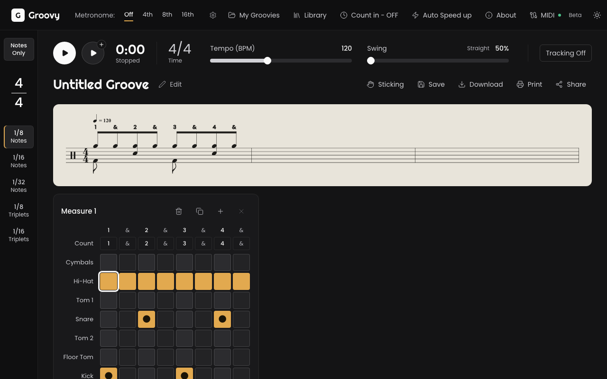

# Groovy

I built Groovy to create, play, and share drum patterns in a browser. It includes notation, practice tools, and audio and MIDI export.

**[Try Groovy](https://www.bahar.co.il/groovy/)**



## Key features

- **Drum grid editor.** Click or drag to add and remove notes. Edit several measures in one groove.
- **Sheet music.** The notation updates as you edit. A cursor follows the playback position.
- **Playback.** Set the tempo and swing. Use the metronome with count-in, or turn on auto speed-up to raise the tempo during practice.
- **Articulations.** Add accents, ghost notes, flams, drags, and buzz rolls.
- **Editing tools.** Undo and redo with Ctrl+Z and Ctrl+Shift+Z (Cmd on macOS). Apply a pattern to a whole voice row with bulk operations.
- **Library.** Start from 18 preset grooves in six styles.
- **Save.** Save your grooves in the browser.
- **Export.** Export as PDF, PNG, SVG, MIDI, MP3, or JSON.
- **Share.** Share a link, post to social media, send by email, show a QR code, or embed a groove on another page.
- **MIDI input (beta).** Connect a MIDI drum kit in Chrome or Edge. The app shows your timing against the metronome.

## Getting started

You need Node.js (LTS) and npm.

```bash
npm install
npm run dev
```

Open [http://localhost:5173](http://localhost:5173) in your browser.

Copy `.env.example` to `.env.local` if you need the optional `VITE_` variables. The file describes each variable.

| Command | Purpose |
|---------|---------|
| `npm run dev` | Start the development server on port 5173 |
| `npm run build` | Type-check the code and build to `dist/` |
| `npm run build:prod` | Build with the production base path (`/groovy/`) |
| `npm run preview:prod` | Serve the production build at [http://localhost:4173/groovy/](http://localhost:4173/groovy/) |
| `npm run type-check` | Run the TypeScript compiler without writing files |
| `npm test` | Run the test suite once with Vitest |
| `npm run lint` | Run ESLint |

## Technology and architecture

### Stack

- **React 18.3** and **React Router 7** for the user interface
- **TypeScript 5.6** in strict mode
- **Vite 6** for the build, and **Tailwind CSS 4** for styling
- **Radix UI** primitives for accessible components
- **Web Audio API** for drum synthesis and playback
- **Web MIDI API** for device input
- **abcjs 6** for notation rendering
- **Zod** for validation and **DOMPurify** for SVG sanitizing
- **jsPDF**, **midi-writer-js**, **@breezystack/lamejs**, and **qrcode** for export and sharing
- **Vitest** and **Testing Library** for tests

### Layers

The code is split into layers:

- `src/core/` contains the playback engine, audio, storage, the URL codec, and the exporters. This folder has no React imports. You can use the engine without React.
- `src/midi/` contains MIDI input, the velocity and double-trigger filters, and timing analysis.
- `src/hooks/` contains the React hooks that connect the core modules to the user interface.
- `src/components/` and `src/pages/` contain the user interface.

The engine emits typed events. The user interface subscribes to them:

```typescript
import { GrooveEngine } from './core';

const engine = new GrooveEngine();

engine.on('positionChange', (position) => {
  console.log('Current position:', position);
});

engine.on('playbackStateChange', (isPlaying) => {
  console.log('Playing:', isPlaying);
});

await engine.play(groove, true);   // Start a loop
engine.updateGroove(newGroove);    // Apply changes on the next loop
await engine.playPreview('kick');  // Play one drum sound
engine.stop();
engine.dispose();                  // Release resources when you finish
```

### Project structure

```
groovy/
├── src/
│   ├── core/          Playback engine, audio, storage, URL codec, exporters
│   ├── midi/          MIDI input, filters, and timing analysis
│   ├── hooks/         React hooks that connect the core to the UI
│   ├── components/    Editor components (production/ subfolder)
│   ├── pages/         ProductionPage (editor), EmbedPage, NewUIPage
│   ├── newUI/         Components for the /newUI route
│   ├── contexts/      Theme context
│   ├── services/      URL shortener client
│   ├── utils/         Storage helpers, analytics, logger
│   ├── data/          Preset library (libraryGrooves.json)
│   ├── types.ts       Shared types
│   ├── App.tsx        Routes and embed mode
│   └── main.tsx       Entry point
├── public/
│   ├── sounds/        Drum samples (MP3)
│   └── images/        Open Graph image
├── docs/              User guide, UI rules, and reference notes
├── DEPLOYMENT.md      Deployment steps
└── vite.config.ts     Build configuration and base path
```

## Development and deployment

### Tests and checks

Run `npm test` for the unit tests. Run `npm run type-check` and `npm run lint` before you open a pull request.

### Base path

The app deploys to `/groovy/` by default. The base path is set by the `VITE_BASE_PATH` variable. The default is in `vite.config.ts`. For a local preview, use `npm run preview:prod`.

### Deployment

The production site runs at [https://www.bahar.co.il/groovy/](https://www.bahar.co.il/groovy/). The steps to deploy are in [DEPLOYMENT.md](DEPLOYMENT.md). The file `public/.htaccess` sets the Content-Security-Policy and other response headers for the Apache server.

### Documentation

- [GETTING_STARTED.md](GETTING_STARTED.md): setup notes for a new machine
- [DEPLOYMENT.md](DEPLOYMENT.md): deployment steps
- [docs/USER_GUIDE.md](docs/USER_GUIDE.md): how to use the editor
- [docs/UI-RULES.md](docs/UI-RULES.md): rules for the user interface
- [MIDI_SPEC_AUDIT.md](MIDI_SPEC_AUDIT.md): audit of the MIDI timing specification

## Roadmap

### Done

- Core engine, audio synthesis, and playback timing
- Swing, tempo, and metronome controls
- Grid editor with multiple measures, drum voices, and articulations
- Undo and redo
- Sheet music with ABC notation
- Export to MIDI, MP3, PDF, PNG, SVG, and JSON
- Save grooves in the browser
- Preset library and bulk operations
- Sharing by link, social media, email, QR code, and embed
- Responsive layout with touch targets of at least 44 px
- Security headers and SVG sanitizing

### Open

- MIDI import
- Cloud storage
- User accounts
- Note-by-note accuracy tracking and mistake detection during playback

## License

Groovy is released under the [MIT License](LICENSE).

## Credits

- **GrooveScribe**: the original implementation, which is a legacy codebase.
